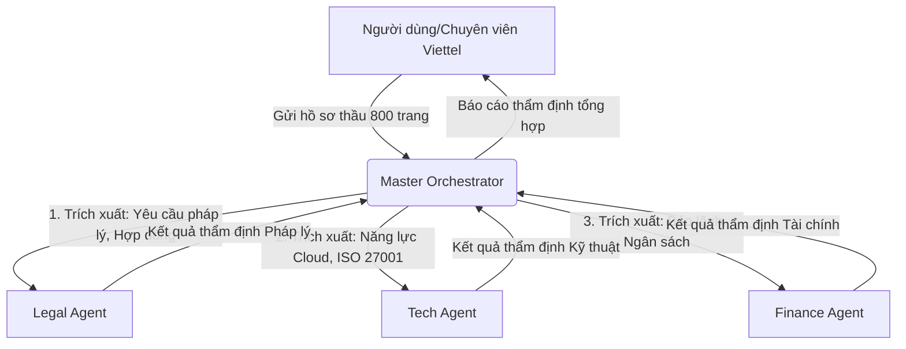

# Tài liệu Thiết kế Kiến trúc Đa tác tử phân cấp (Hierarchical Multi-Agent)
**Dự án:** Phân tích hồ sơ thầu dự án Thành phố thông minh - Viettel Solutions
**Mã bài tập:** AI301_S08_BTVN_M1_BT1

---

## Nhiệm vụ 1: Mô hình hóa kiến trúc phân cấp
Mô hình Đa tác tử phân cấp được thiết kế theo cấu trúc Master-Subagent. Master Orchestrator đóng vai trò là "Tổng chỉ huy", tiếp nhận toàn bộ hồ sơ dài 800 trang và điều phối công việc cho 3 Subagents chuyên trách. 

Sơ đồ quan hệ giữa các tác tử:

## Nhiệm vụ 2: Phân định ranh giới trách nhiệm và bộ công cụ
Mỗi tác tử được quy định nghiêm ngặt về chức năng và bộ công cụ (Tools) nhằm đảm bảo phân tích chuyên sâu và tránh sự chồng chéo nhiệm vụ.

**1. Master Orchestrator (Tác tử Điều phối)**
*   **Trách nhiệm:** Tiếp nhận hồ sơ đầu vào, chia nhỏ tài liệu, phân phối nhiệm vụ cho các Subagents, giải quyết xung đột thông tin và tổng hợp báo cáo cuối cùng.
*   **Bộ công cụ:** `Document_Parser` (Quét và chia nhỏ văn bản), `Semantic_Router` (Phân luồng dựa trên ngữ nghĩa), `Report_Synthesizer` (Định dạng báo cáo).

**2. Legal Agent (Tác tử Pháp lý)**
*   **Trách nhiệm:** Kiểm tra tính hợp lệ của hồ sơ dự thầu, phân tích các rủi ro trong điều khoản hợp đồng và đánh giá tính tuân thủ pháp luật (bao gồm ràng buộc pháp lý của chứng chỉ ISO 27001).
*   **Bộ công cụ:** `Contract_Analyzer` (Phân tích điều khoản hợp đồng), `Legal_Knowledge_Base` (Tra cứu quy định pháp luật và chính sách nội bộ Viettel).

**3. Tech Agent (Tác tử Kỹ thuật)**
*   **Trách nhiệm:** Thẩm định năng lực kỹ thuật bao gồm cấu hình máy chủ đám mây, kiến trúc hệ thống, và các tiêu chuẩn kiểm soát an toàn thông tin theo yêu cầu ISO 27001.
*   **Bộ công cụ:** `Tech_Spec_Validator` (Đối chiếu thông số kỹ thuật), `Cyber_Security_Checker` (Đánh giá chuẩn bảo mật).

**4. Finance Agent (Tác tử Tài chính)**
*   **Trách nhiệm:** Đánh giá năng lực tài chính, kiểm tra tính hợp lệ của bảng bảo lãnh ngân hàng, tính toán cơ cấu chi phí và dòng tiền dự án.
*   **Bộ công cụ:** `Table_Data_Extractor` (Trích xuất dữ liệu bảng biểu/số liệu tài chính), `Budget_Calculator` (Tính toán và đối soát ngân sách).

## Nhiệm vụ 3: Thiết lập quy tắc phân bổ công việc
Việc đưa toàn bộ 800 trang vào ngữ cảnh (context window) của một LLM là không khả thi. Orchestrator sẽ xử lý phân bổ theo 4 bước:

**Bước 1: Quét và Lập chỉ mục (Scanning & Indexing)**
Orchestrator sử dụng `Document_Parser` để đọc Mục lục (Table of Contents) và các tiêu đề chính, chia nhỏ 800 trang tài liệu thành các phân đoạn (chunks) độc lập có gắn thẻ nội dung (metadata).

**Bước 2: Phân loại theo ngữ nghĩa (Semantic Routing)**
Dựa trên từ khóa và ngữ cảnh, Orchestrator chia tách tài liệu:
*   **Phần Pháp lý:** Trích xuất các chương chứa "Điều kiện chung", "Thỏa thuận", giao cho Legal Agent.
*   **Phần Kỹ thuật:** Trích xuất các trang có "ISO 27001", "Cloud Server", "Băng thông", giao cho Tech Agent.
*   **Phần Tài chính:** Trích xuất các trang "Bảo lãnh ngân hàng", "Bảng giá", "Dòng tiền", giao cho Finance Agent.

**Bước 3: Giao việc song song (Parallel Execution)**
Orchestrator thiết lập các Prompt cụ thể cho từng phần tài liệu đã cắt nhỏ và kích hoạt 3 Subagents thẩm định đồng thời để tối ưu hóa thời gian chạy.

**Bước 4: Tổng hợp và Đối chiếu (Synthesis)**
Khi nhận lại kết quả, Orchestrator thực hiện đối chiếu chéo (ví dụ: đảm bảo chi phí triển khai Cloud của Tech Agent khớp với báo giá của Finance Agent) trước khi xuất báo cáo thẩm định cuối cùng cho chuyên viên Viettel.